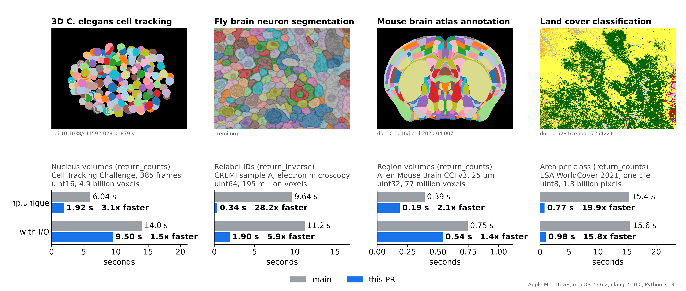

# A faster `np.unique`: demo

The `numpy` submodule holds a proposed change to `np.unique`: lookup tables
for integers in a small range, a faster hash set, optional results
(`return_counts`, `return_inverse`, `return_index`) without sorting, and a
fallback to sorting when hashing would not pay. This repository compares it
with NumPy `main` on four real label datasets.

On an Apple M1 the `np.unique` call is 2.1x to 28x faster, and 1.4x to 16x
faster when reading the file is counted too.
[`demo-executed-apple-m1.ipynb`](demo-executed-apple-m1.ipynb) is the notebook
with its outputs from that run, made with `DEMO_STATIC=1` so that it shows
still frames where the live notebook has a movie player. Its last section makes
the figure.

## Running it

    git clone --recurse-submodules <this repository>
    pixi run data      # downloads the data
    pixi run lab       # builds both NumPy variants, then opens demo.ipynb
    pixi run plot      # writes summary.png

`pixi.toml` defines three environments:

| environment | NumPy |
|---|---|
| `main` | upstream `main`, built from source |
| `tables` | the `numpy` submodule: the same commit plus the `np.unique` changes |
| `default` | a release, with JupyterLab; the notebook runs here and starts the other two |

Needs [pixi](https://pixi.sh), git and a C and C++ compiler, on Linux or macOS,
with about 6 GB of disk. The first run compiles NumPy twice, which takes about
ten minutes.

`pixi run data` fetches 260 MB from the publishers named at the end of the
notebook, and the *C. elegans* movies, which come as a 3.4 GB archive from a
slow server (allow an hour). The embryo cells load both movies into 8.6 GB of
shared memory; set `FRAME_STEP = 2` in the notebook to halve that.

After changing the submodule, rebuild with `pixi reinstall -e tables numpy`.

## License

The code in this repository is under the MIT license (see `LICENSE`). The
`numpy` submodule has NumPy's own license. The datasets keep the terms of
their publishers, which are named at the end of the notebook, and so do the
images derived from them in `assets`, `summary.png` and the executed notebook.
